<div align="center"></div>

### Nola，一个基于 Ktor(Kotlin) 的博客系统（开发中...）。

博客预览（开发中）：[loac.cc](https://loac.cc)

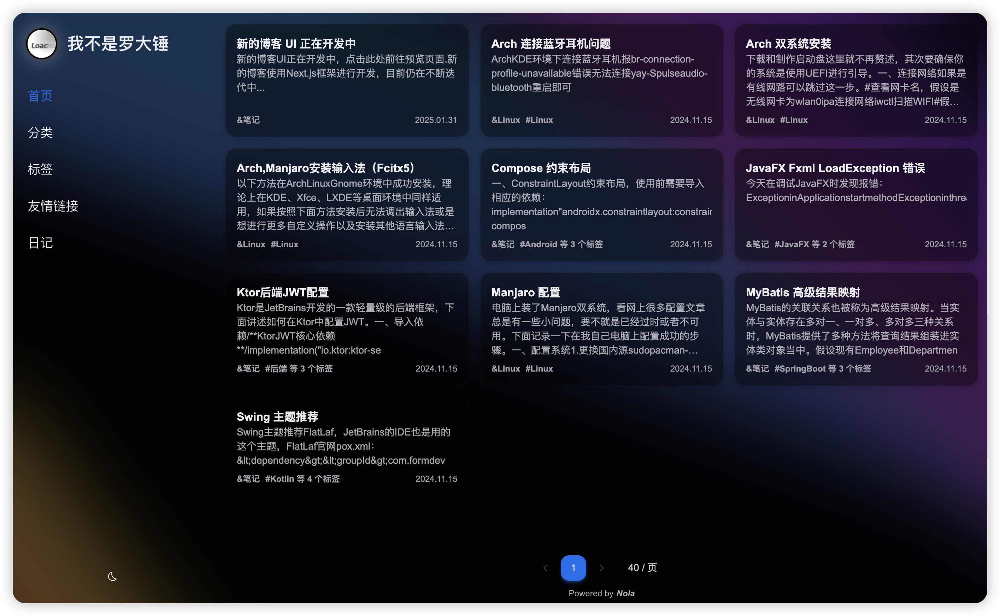

Nola 博客采用完全前后端分离开发，本体就是当前 Nola 仓库，只提供了博客的一些常用的接口，没有内嵌博客前端页面。

Nola 没有采用传统的使用模板引擎然后用后端服务渲染后将页面给前端的方式（一开始考虑过，后来还是做成完全分离，博客前端单独做）。

Nola 内嵌了一个 Web 控制面板，在跑起来 Nola 后可以通过访问 [http://localhost:8098/console](http://localhost:8098/console) 进行博客的初始化和管理。

目前博客仍在开发阶段，部分配置可能还需要手动在项目静态文件中修改，后续会提供更方便的配置方式。


### 一、🔨 运行 Nola

环境要求：

- JDK 17
- MySQL 8+ 或 MariaDB 10.11+
- Redis 6+（用于登录会话存储，必须启动）

1. 首先你需要先 clone 本仓库到本机。
2. 使用 IDEA 打开项目，并完成 Gradle 依赖加载。
3. 修改 `src/main/resources/application.conf` 文件中的数据库和 Redis 配置。
4. 从 `Application.kt` 中的 `main` 方法运行 Nola。
5. 访问 [http://localhost:8098/console](http://localhost:8098/console) 完成博客初始化。

开发测试可运行 `./gradlew test`。

初始化管理员应在首次部署后立即完成，并建议通过防火墙或反向代理限制 `/console`、`/admin` 的来源地址。


### 二、🚀 生产部署

生产环境使用 `config/application-prod.conf` 模板，敏感配置通过环境变量注入；生产模式会拒绝使用默认数据库密码、过短 JWT 密钥或 `anyHost` CORS 启动。

#### 1. 构建与启动

```bash
./gradlew clean buildFatJar
java -jar build/libs/nola-all.jar -config=config/application-prod.conf
```

#### 2. 环境变量

| 变量 | 说明 | 默认值 |
|---|---|---|
| `NOLA_HOST` / `NOLA_PORT` | 监听地址和端口 | `0.0.0.0` / `8098` |
| `NOLA_DB_DRIVER` | JDBC 驱动类名 | `com.mysql.cj.jdbc.Driver` |
| `NOLA_DB_URL` | JDBC 连接地址 | 本机 `nola` 数据库 |
| `NOLA_DB_NAME` | 数据库名，必须与 JDBC URL 中的库名一致 | `nola` |
| `NOLA_DB_USER` / `NOLA_DB_PASSWORD` | 数据库账号密码，密码不能为空或 `123456` | `root` / 空 |
| `NOLA_REDIS_URL` | Redis 地址 | `redis://localhost:6379` |
| `NOLA_JWT_ISSUER` / `NOLA_JWT_DOMAIN` | JWT 发行者和站点地址 | `https://api.example.com` |
| `NOLA_JWT_SECRET` | JWT 密钥，至少 32 位随机字符串 | 空（生产必填） |
| `NOLA_JWT_AUDIENCE` | JWT 受众 | `users` |
| `NOLA_CORS_ALLOWED_HOSTS` | 允许的前端 Origin，逗号分隔，如 `https://blog.example.com` | 配置文件中的值 |
| `NOLA_CORS_ANY_HOST` | 是否允许任意来源，仅开发使用 | `false` |
| `NOLA_TRUSTED_PROXIES` | 可信反向代理 IP，逗号分隔，只有这些地址的转发头会被采纳 | 本机回环地址 |
| `NOLA_BACKUP_INTERVAL_HOURS` | 自动备份间隔小时数，`0` 关闭定时备份 | `24` |
| `NOLA_BACKUP_RETENTION_DAYS` | 备份保留天数 | `30` |
| `NOLA_BACKUP_RETENTION_COUNT` | 最多保留的备份份数 | `20` |

#### 3. 反向代理与 HTTPS

参考 [config/nginx-nola.conf.example](config/nginx-nola.conf.example)。Nginx 需转发 `Host`、`X-Real-IP`、`X-Forwarded-For` 和 `X-Forwarded-Proto`，并将 `NOLA_TRUSTED_PROXIES` 设置为 Nginx 的出口地址（本机部署为 `127.0.0.1`）。

Nginx 示例已关闭代理缓冲并设置 WebSocket/SSE 所需的超时；`client_max_body_size` 需覆盖 60MB 的备份恢复包限制。

#### 4. 健康检查与安全

- `GET /health`：返回数据库和 Redis 是否可用；全部正常为 `200`，否则为 `503`，不返回连接串或异常栈。
- 服务默认添加 `X-Content-Type-Options`、`X-Frame-Options`、`Referrer-Policy`、`Permissions-Policy` 等响应头；通过可信代理识别到 HTTPS 时自动添加 HSTS。
- 停止服务时会先停止接收请求，等待在途请求完成（默认最多 30 秒），再释放数据库和 Redis 连接池。

#### 5. 备份与恢复

- 管理端可手动导出备份，默认每 24 小时自动备份一次，并按保留策略清理 `.nola/backup`。
- 恢复采用“上传 zip 预览 → 使用预览令牌确认”的流程，只恢复文章正文与草稿，不包含标签、分类、配置等元数据；新文章以 slug 作为标题，恢复前请在预览中确认冲突处理策略。
- 备份下载和恢复接口都需要管理员身份验证。


### 三、🔨 Nola 博客前端页面

Nola 并没有内嵌博客前端页面，你需要拉取 [Nola-Blog](https://github.com/LuodachuiXG/nola-next-blog) 仓库后在本地编译运行后才可以正常看到前端页面。

[Nola-Blog](https://github.com/LuodachuiXG/nola-next-blog) 使用 Next.js 进行开发，支持服务端渲染。

1. 首先 clone [Nola-Blog](https://github.com/LuodachuiXG/nola-next-blog) 仓库到本地。
2. 使用你喜欢的前端 IDE 打开项目。
3. 打开根目录中的 `.env.development` 文件，在里面配置你的 Nola 服务器地址（默认 http://localhost:8098 无需修改）。
4. 运行 `npm install` 拉取依赖。
5. 运行 `npm run dev` 运行。


### 四、🔩 Nola API 文档

Nola 有详细的 API 文档，使用 Apifox 进行编写，API 文档地址：[API 文档](https://apifox.com/apidoc/shared-82cab87c-63f3-4613-9264-69f4b68528ce)


### 五、🛠 其他相关仓库

1. Nola 博客前端页面：[Nola-Blog](https://github.com/LuodachuiXG/nola-next-blog)
   - Next.js 框架，支持服务端渲染。使用 [HeroUI](https://www.heroui.com/) 组件库 + [TailwindCSS](https://tailwindcss.com/) 进行UI 开发。
2. Nola 控制台页面：[Nola-Console](https://github.com/LuodachuiXG/Nola-Console)
   - Vue3 框架。使用 [Naive UI](https://www.naiveui.com/zh-CN/os-theme)（后续可能更换重写）。
3. Nola Android 端：[Nola-Android](https://github.com/LuodachuiXG/Nola-Android)
   - 目前处于新建文件夹阶段，预计使用 Jetpack Compose 进行开发。
4. Nola Apple 端：[Nola-iOS](https://github.com/LuodachuiXG/Nola-Apple)
   - SwiftUI 为主 + UIKit 混合开发，目前进度 40% 左右，应该会较于 Android 版本更早完成。


### 六、📷 部分截图

由于目前仍在开发中，截图仅供参考。

#### 1. Nola 控制台

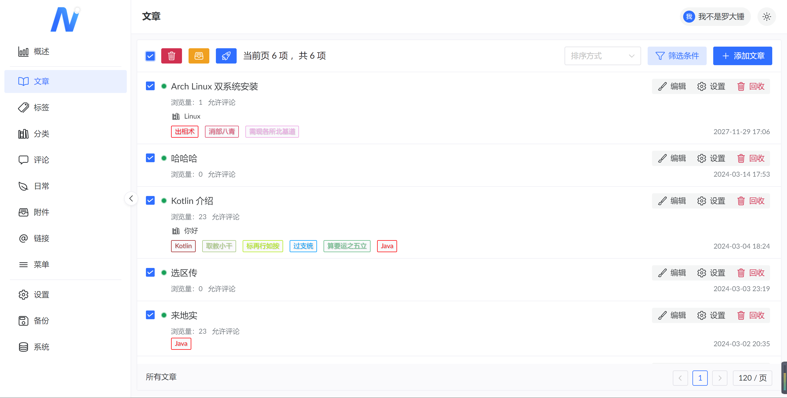
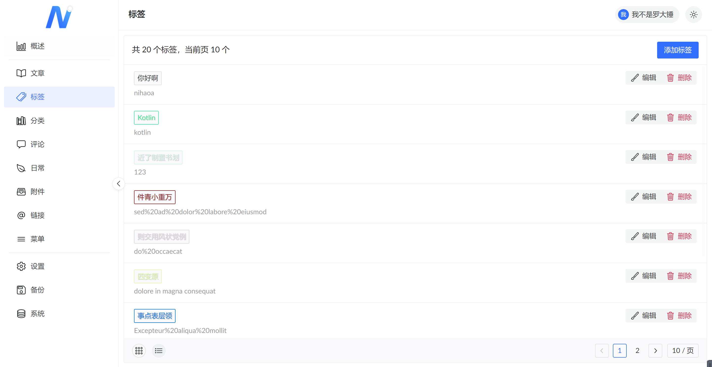
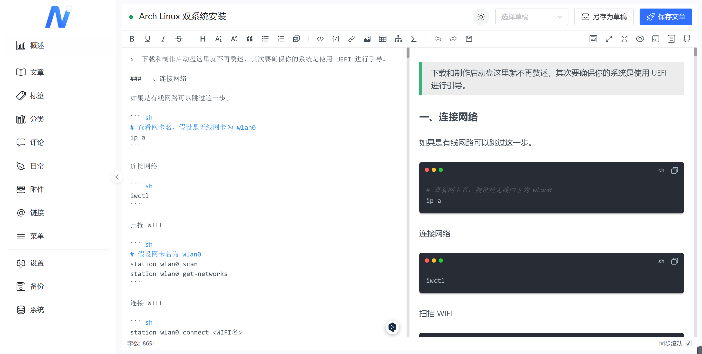

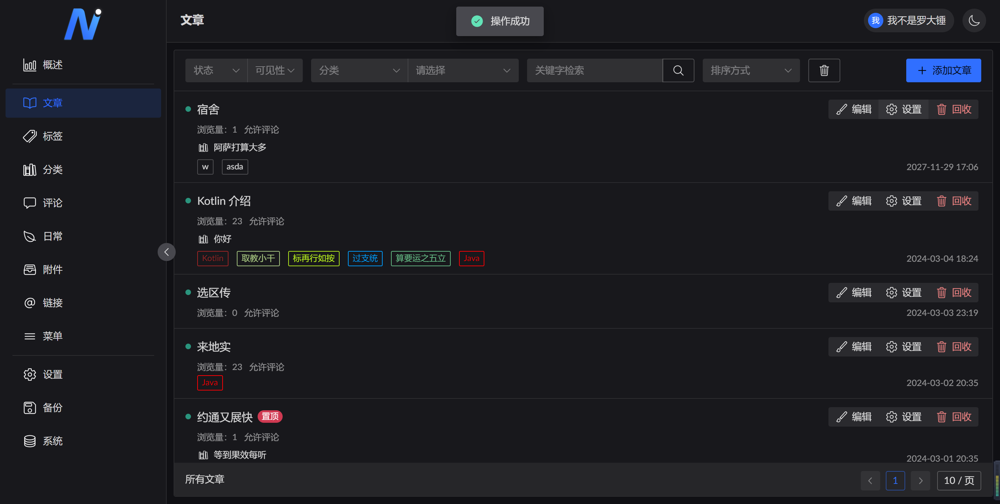

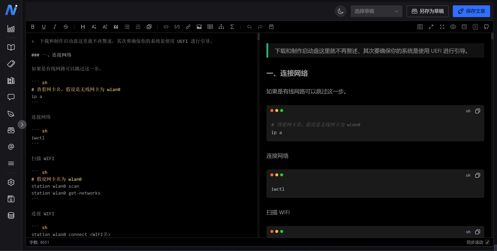

#### 2. Nola 博客前端

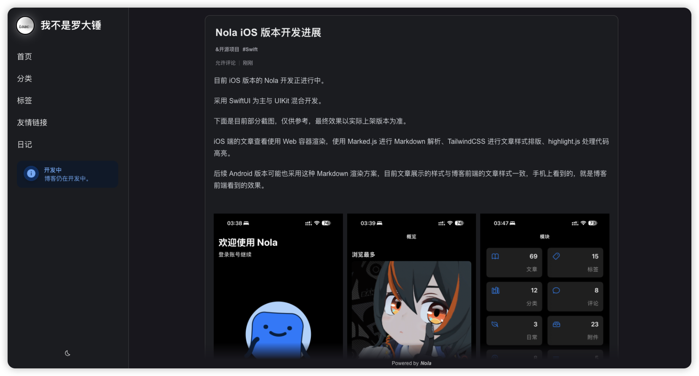

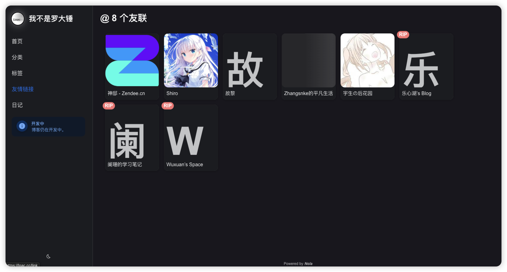


#### 3.Nola Apple 端
<div style="display: flex; gap: 10px; flex-wrap: wrap;">
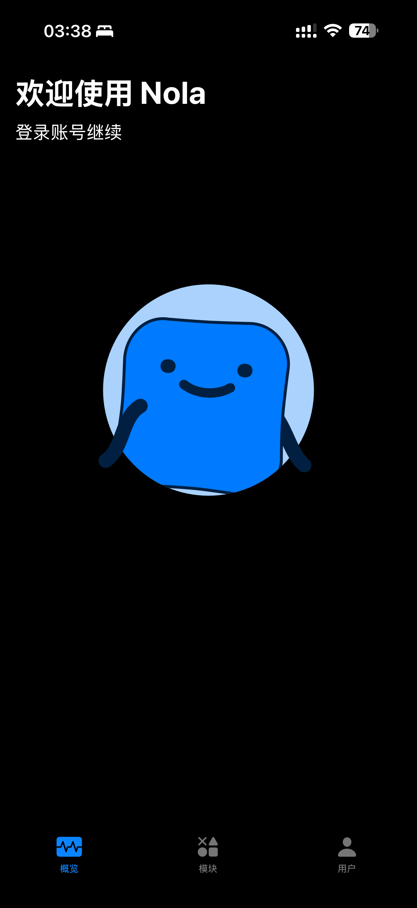
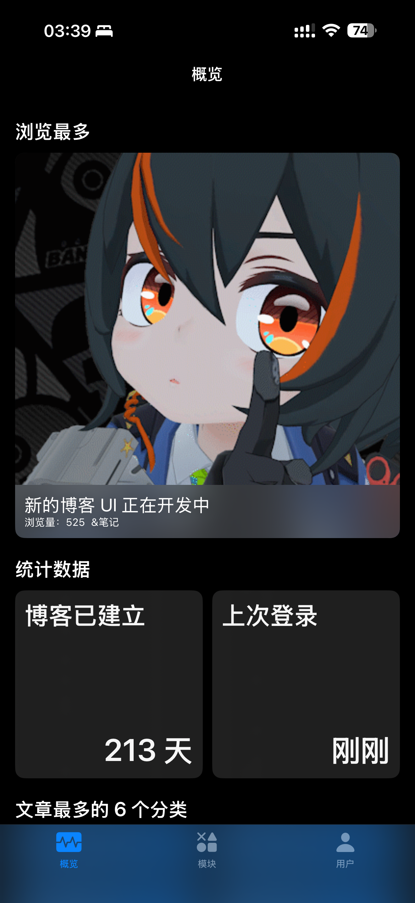
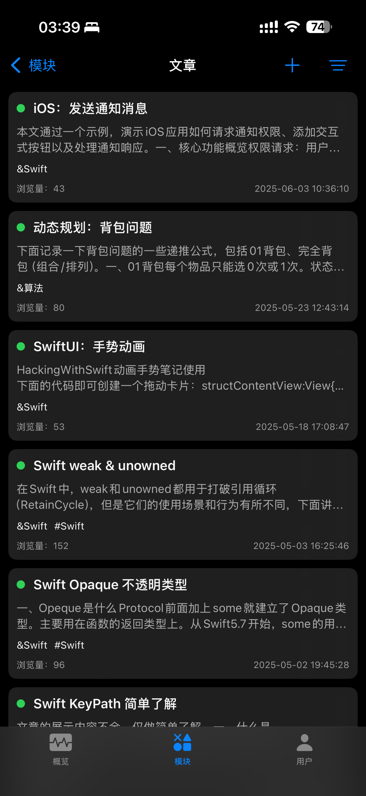
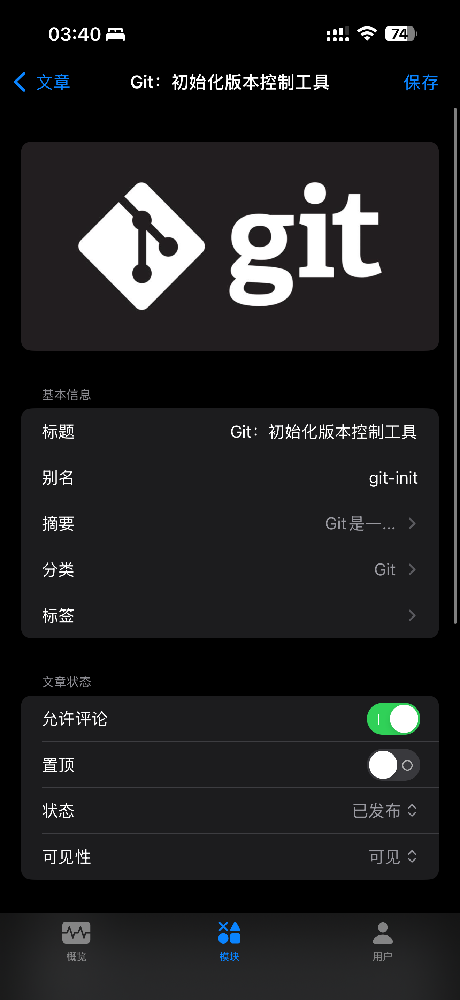
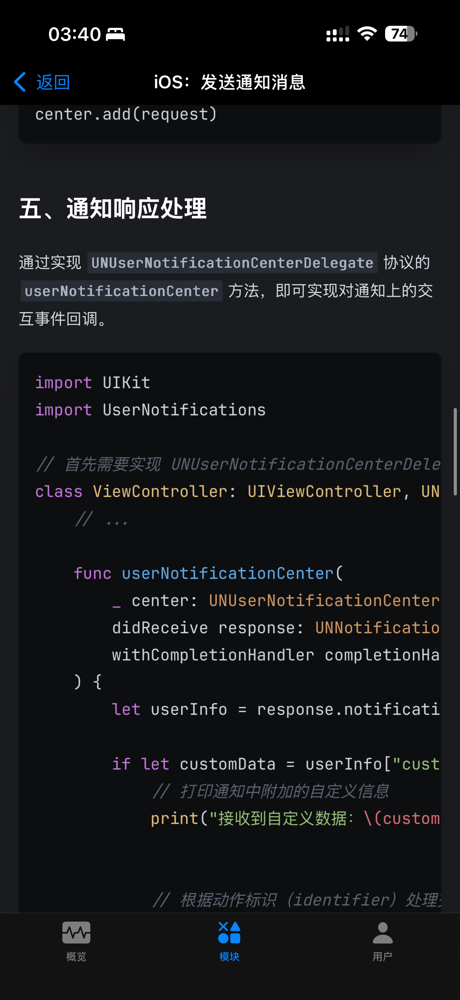
</div>